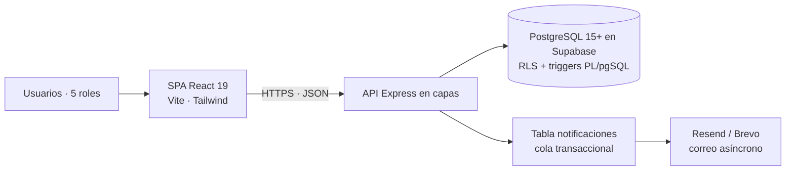

<div align="center">

# 🏗️ Remodela sin sustos

**Cotizaciones comparables, acuerdos formales y sobrecostos visibles *antes* de pagar.**

Plataforma web para coordinar remodelaciones residenciales con múltiples contratistas independientes.

`React 19` · `Vite 8` · `Tailwind CSS` · `Express` · `Supabase (PostgreSQL 15+)` · `Vercel`

</div>

---

## El problema que resuelve

Coordinar una remodelación con contratistas independientes parece sencillo… hasta que llegan los sustos. El caso que motivó este proyecto es el de **Obra Clara S.A.S.**, una empresa medellinense que dirige hasta tres obras en simultáneo con contratistas de perfil muy distinto —llave en mano, por administración, o taller de acabados que cobra materiales y mano de obra por separado—. En ese escenario, la coordinación fracasaba siempre por los mismos tres motivos:

1. **Cotizaciones incomparables.** Cada contratista cotizaba en su propio formato y escondía exclusiones, haciendo imposible una comparación honesta entre ofertas.
2. **Acuerdos de palabra y por WhatsApp.** Sin respaldo formal ni trazabilidad, cualquier reclamo terminaba en "yo entendí otra cosa".
3. **Reportes tardíos.** Los sobrecostos se descubrían cuando ya se pedía el desembolso — como el 18 % de sobrecosto de una obra en Sabaneta, hallado demasiado tarde, con el dinero ya pagado.

**Remodela sin sustos** cierra esas tres brechas: fuerza un alcance oficial único, cotizaciones estructuradas bajo el mismo formato, acuerdos vinculantes exportables a PDF, avance diario reportado desde obra y pagos liberados solo contra avance físico sustentado.

## Funcionalidades (Release 1 — completada)

| Historia | Qué hace |
| --- | --- |
| **US-01 · Alcance Oficial** | Definición jerárquica de la obra (Ambientes → Partidas → Materiales) con sellado formal y candado de inmutabilidad: todos cotizan lo mismo. |
| **US-02 · Cotización estructurada** | Formulario de campo *phone-first* con 5 rubros obligatorios (materiales, mano de obra, imprevistos, tiempo e hitos que suman 100 %) y cláusula forzada de exclusiones: nada escondido. |
| **US-03 · Comparador matricial** | Matriz homogénea de ofertas con identificación automática de menor costo y menor tiempo. |
| **US-04 · Acuerdo Vinculante** | Formalización del acuerdo con exportación a PDF en 1 hoja, tipografía formal y líneas de firma. |
| **US-05 / US-06 · Avance de jornada** | Reporte móvil del contratista con borrador guardado offline y alerta inmediata de desviación de costos. |
| **US-07 · Hitos y pagos** | Pagos condicionados al avance físico sustentado: no hay doble pago ni desembolsos por adelantado. |
| **US-11 · Roles y acceso** | Autenticación por roles, rutas protegidas con `RequireRole` y aislamiento de obras por contratista. |

### Roadmap (Release 2)

- **US-08** · Portal del Cliente Propietario (`/cliente`).
- **US-09** · Vista consolidada de portafolio y rentabilidad para Gerencia (`/portafolio`).
- **US-10** · Registro inmutable de cambios de alcance posteriores a la firma.
- **US-12** · Verificación de rendimiento, disponibilidad (`/health`) y tiempos de respuesta ≤ 5 s.

## Roles del sistema

| Rol | Qué ve y hace |
| --- | --- |
| `coordinador` | Administra obras, compara cotizaciones, formaliza acuerdos y libera pagos. |
| `auxiliar` | Asistente de coordinación. |
| `contratista` | Vista de campo *mobile-first* para cotizar y reportar avance diario. Solo ve sus obras asignadas. |
| `cliente` | Solo lectura de su propio acuerdo y avance. |
| `gerencia` | Vista consolidada de portafolio y rentabilidad. |

## Arquitectura

Cinco piezas, deliberadamente simples (el detalle y el porqué de cada decisión están en los [ADR](docs/04_Decisiones/ADR_Decisiones_Arquitectura.md)):

1. **Frontend:** una sola SPA en React 19 + Vite + React Router DOM v7 + Tailwind CSS + TanStack Query.
2. **Backend:** API Express (Node.js) en capas — `routes → controllers → services → repositories`.
3. **Base de datos & BaaS:** Supabase (PostgreSQL 15+) con Row Level Security activo y JWT con *custom claims* por rol.
4. **Reglas de negocio en la BD:** triggers transaccionales en PL/pgSQL e índices únicos parciales — imposibles de saltar desde el cliente.
5. **Notificaciones:** cola transaccional en la tabla `notificaciones` + correo asíncrono vía Resend / Brevo.



**Despliegue:** Vercel — frontend estático + API serverless bajo `/api` (ver `vercel.json`).

## Estructura del repositorio

```text
Remodela-sin-sustos/
├── api/            # Adaptador serverless de la app Express para Vercel Functions
├── docs/           # Documentación oficial: MOC, visión C4, módulos, guías y ADR
├── scripts/        # Pruebas de flujo automatizadas y seed de datos (Node.js)
├── server/        # API REST Express en 3 capas (controllers · services · repositories)
├── src/            # SPA React: páginas, features por módulo y autenticación
├── supabase/       # Migraciones SQL versionadas: esquema, RLS y triggers
└── index.html      # HTML base montado por Vite
```

El mapeo archivo por archivo, con el propósito exacto de cada uno, está en el documento de estructura interna del repositorio.

## Puesta en marcha

Requisitos: Node.js (versión LTS recomendada), npm y un proyecto en Supabase (PostgreSQL 15+).

```bash
# 1. Instalar dependencias
npm install

# 2. Configurar variables de entorno (.env — ignorado por git)
#    Seguir docs/03_Guias/03_Guia_Setup_Despliegue.md

# 3. Aplicar las migraciones de supabase/migrations/ en orden:
#    esquema → RLS → triggers (CLI de Supabase o editor SQL)

# 4. Poblar datos de prueba (empresas, obras, usuarios)
node scripts/seed.mjs

# 5. Levantar la API local (puerto 3000)
node server/dev.js

# 6. Levantar el frontend
npm run dev
```

Verifica que todo respira con el chequeo de conectividad y estado (`GET /health`):

```bash
node scripts/probar-api.mjs
```

### Pruebas de flujo automatizadas

```bash
node scripts/flujo-cotizacion.mjs   # UC1–UC4: alcance → cotizar → comparar → acuerdo
node scripts/flujo-obra.mjs          # UC5–UC8: avance → desviación → hitos → pagos
```

### Producción

```bash
npm run build   # Compila la SPA para producción
```

El despliegue en Vercel está previsto en `vercel.json`: frontend estático y funciones serverless bajo `/api`.

## Documentación

| Documento | Contenido |
| --- | --- |
| [`docs/00_MOC/_MOC_MAESTRO.md`](docs/00_MOC/_MOC_MAESTRO.md) | Mapa de Contenido Maestro que interconecta toda la documentación. |
| [`docs/01_Arquitectura/01_Vision_Arquitectura.md`](docs/01_Arquitectura/01_Vision_Arquitectura.md) | Contexto, modelo C4 y matriz de requisitos (RF / RNF). |
| [`docs/02_Modulos/02_Frontend_SPA.md`](docs/02_Modulos/02_Frontend_SPA.md) | Especificación de interfaz, rutas protegidas y componentes. |
| [`docs/02_Modulos/03_Backend_API_DB.md`](docs/02_Modulos/03_Backend_API_DB.md) | Endpoints Express, esquema Postgres, triggers y RLS. |
| [`docs/03_Guias/03_Guia_Setup_Despliegue.md`](docs/03_Guias/03_Guia_Setup_Despliegue.md) | Guía paso a paso de variables, seed y despliegue. |
| [`docs/04_Decisiones/ADR_Decisiones_Arquitectura.md`](docs/04_Decisiones/ADR_Decisiones_Arquitectura.md) | Registro de decisiones arquitectónicas (ADR-01 a ADR-05). |

## Autores

Proyecto académico desarrollado por:
* **Johan Emmanuel David Garcés** — Código: `202410243`
* **Juan Esteban Acevedo Patiño** — Código: `202420016`

**Materia:** *Aplicación de Metodologías de Diseño de Software*  
**Docente:** María Eugenia González Pérez  
**Institución:** Institución Universitaria Salazar y Herrera — Ingeniería de Sistemas  
**Medellín, 2026**
