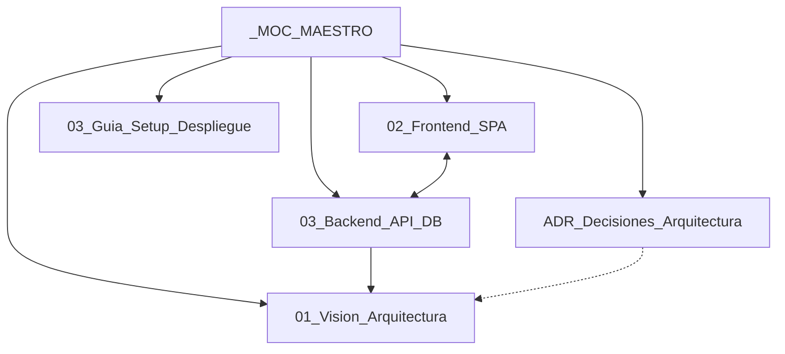

# 🏛️ Mapa de Contenido Maestro (MOC) — Remodela sin sustos

Bienvenido al compendio de documentación arquitectónica y técnica de **Remodela sin sustos**, compilado bajo el protocolo **Summa**. Este índice interconecta los módulos, guías y decisiones del sistema.

---

## 📑 Tratados del Sistema

### 1. [[01_Vision_Arquitectura|01. Visión y Arquitectura del Sistema]]
* Contexto empresarial del caso ancla (*Obra Clara S.A.S.*).
* Modelo de Arquitectura C4 simplificado (Nivel 1 y Nivel 2).
* Mapeo de Requisitos Funcionales (RF-01 a RF-10) y No Funcionales (RNF-01 a RNF-05).
* Matriz de Trazabilidad de Historias de Usuario (US-01 a US-12).

### 2. [[02_Frontend_SPA|02. Módulo Frontend SPA]]
* Arquitectura de interfaz en React 19 + React Router v7 + Tailwind CSS.
* Modelo de navegación y protección de rutas por roles (`RequireRole` y `AuthContext`).
* Módulos de interfaz:
  - Definición de Alcance Oficial con jerarquía dinámica (`AlcanceForm`, US-01).
  - Cotización estructurada de campo phone-first (`CotizacionForm`, US-02).
  - Comparador matricial de cotizaciones (`ComparadorCotizaciones`, US-03).
  - Generador de Acuerdo Formal con exportación en 1 hoja para PDF/impresión (`ComparadorCotizaciones`, US-04).
  - Reporte de avance móvil con guardado offline y alertas de desviación (`RegistroAvanceForm`, US-05/US-06).
  - Panel de control de hitos y pagos contra avance sustentado (`HitosPagoPanel`, US-07).

### 3. [[03_Backend_API_DB|03. Módulo Backend & Base de Datos]]
* API REST en Express con arquitectura en capas (Controladores $\rightarrow$ Servicios $\rightarrow$ Repositorios).
* Modelo relacional en PostgreSQL (8 tablas de dominio + 1 tabla técnica de notificaciones).
* Reglas de negocio transaccionales mediante triggers, funciones PL/pgSQL e índices únicos parciales.
* Políticas de seguridad Row Level Security (RLS) por rol y proyecto (RNF-03).
* Servicio de correo transaccional vía cola `notificaciones` (C4).

### 4. [[03_Guia_Setup_Despliegue|04. Guía de Instalación y Despliegue]]
* Requisitos de entorno y variables de configuración (`.env`).
* Procedimiento de ejecución local de frontend y backend.
* Scripts automatizados de pruebas de flujo (`seed.mjs`, `flujo-cotizacion.mjs`, `flujo-obra.mjs`).
* Despliegue en producción con Vercel Serverless.

### 5. [[ADR_Decisiones_Arquitectura|05. Registro de Decisiones de Arquitectura (ADR)]]
* **ADR-01:** SPA única con rutas por rol vs tres aplicaciones separadas.
* **ADR-02:** Supabase (BaaS) como plataforma backend integrada.
* **ADR-03:** Reglas de negocio críticas en triggers/PostgreSQL vs microservicios.
* **ADR-04:** Control de acceso en base de datos con Row Level Security.
* **ADR-05:** Notificaciones por correo mediante cola asíncrona y webhooks.
