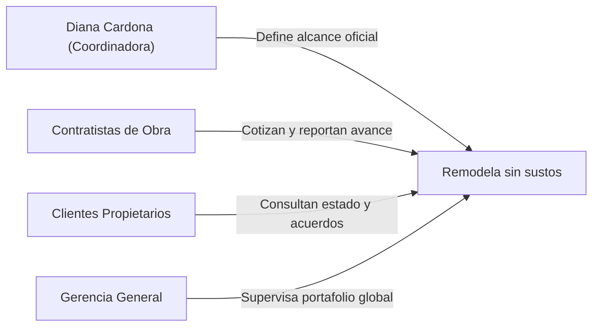
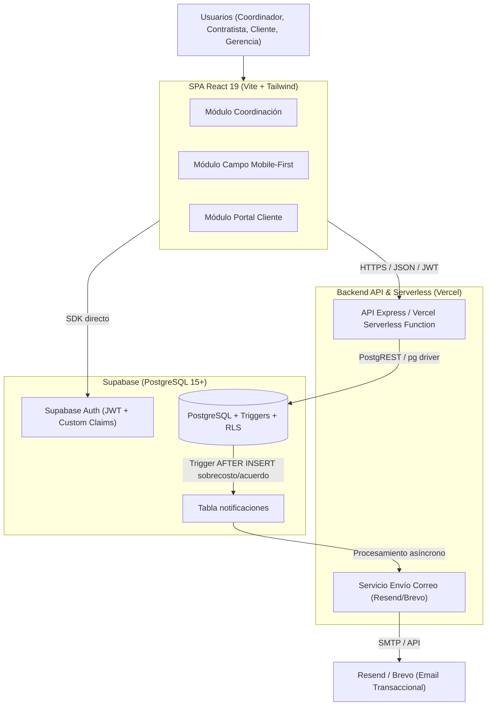

# 🏛️ Visión y Arquitectura del Sistema

## 1. Contexto y Problema del Negocio
El sistema modela y optimiza la operación de **Obra Clara S.A.S.**, pequeña empresa medellinense dedicada a coordinar remodelaciones residenciales en el Valle de Aburrá.

### Obras del Caso Ancla:
1. **Laureles (78 m²):** Presupuesto $21.900.000 — Contratista Integral (Llave en mano).
2. **Sabaneta (120 m²):** Presupuesto $38.500.000 — Maestro de obra por administración. Caso crítico con sobrecosto del 18% detectado tardíamente.
3. **Belén (63 m²):** Presupuesto $14.700.000 — Taller de acabados cotizando mano de obra y materiales por separado.

---

## 2. Diagrama de Contenedores C4 (Nivel 2 Simplificado)

El C4 original de tres aplicaciones separadas se consolidó en una arquitectura ágil y eficiente con 5 piezas:

---

## 3. Matriz de Requisitos y Casos de Uso

| Requisito Funcional | Caso de Uso | Historia de Usuario | Mecanismo de Implementación |
| :--- | :--- | :--- | :--- |
| **RF-01, RF-02** | UC1: Definir alcance | **US-01** | `AlcanceForm.jsx` + Índice único parcial `UNIQUE (proyecto_id) WHERE es_oficial` |
| **RF-03** | UC2: Cotización estructurada | **US-02** | `CotizacionForm.jsx` (5 categorías, exclusiones obligatorias, hitos al 100%) |
| **RF-04** | UC3: Comparar cotizaciones | **US-03** | `ComparadorCotizaciones.jsx` (tabla matricial con menor costo y menor tiempo) |
| **RF-05** | UC4: Acuerdo formal fechado | **US-04** | Función transaccional `aceptar_cotizacion()` + Vista formal Century Schoolbook |
| **RF-07, RF-09** | UC5: Reportar avance y costos | **US-05, US-06** | `RegistroAvanceForm.jsx` + Trigger de cálculo de desviación en tiempo real |
| **RF-08** | UC8: Pago de hitos | **US-07** | `HitosPagoPanel.jsx` + Trigger `BEFORE UPDATE` que impide pasar de `PAGADO` a otro estado |
| **RF-05, RF-07** | UC7: Consultar estado cliente | **US-08** | Portal del cliente (Release 2) con datos aislados por RLS |
| **RF-10** | UC6: Consolidado portafolio | **US-09** | Vista de gerencia paginada con sobrecostos destacados |
| **RF-06** | UC9: Cambio de alcance | **US-10** | Tabla `historial_cambios` append-only (`REVOKE UPDATE, DELETE`) |

---

## 4. Requisitos No Funcionales (RNF)
* **RNF-01 (Usabilidad no técnica):** Interfaz limpia, lenguaje cotidiano sin jerga contable, curva de aprendizaje $\le 2$ horas.
* **RNF-02 (Integridad e inmutabilidad):** 100% de acuerdos, pagos e historiales versionados; disparadores en Postgres rechazan updates o deletes ilegítimos. Retención $\ge 5$ años.
* **RNF-03 (Seguridad y privacidad estricta):** Autenticación obligatoria en el 100% de operaciones. Aislamiento estricto por proyecto y rol garantizado por Row Level Security.
* **RNF-04 (Disponibilidad continua):** Disponibilidad $\ge 99\%$ mensual con endpoint de monitoreo `/health` y tiempo de recuperación $\le 4$ horas.
* **RNF-05 (Operación móvil de campo):** Interfaz optimizada para teléfonos de gama media/baja; reporte de jornada con peso de payload $< 2\text{ MB}$ y carga $\le 5\text{ s}$ sobre redes móviles.
