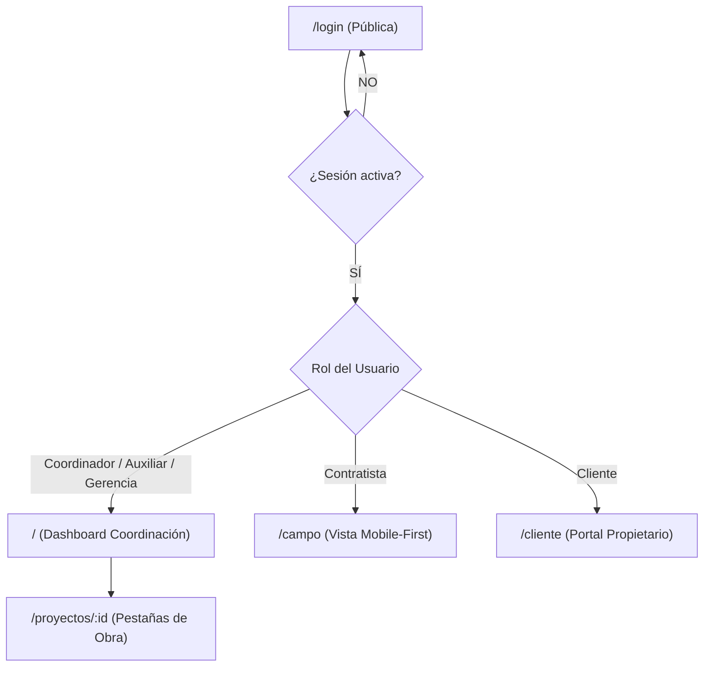

# 💻 Módulo Frontend SPA

## 1. Arquitectura y Tecnologías
* **Framework:** React 19 + Vite 8.
* **Enrutamiento:** React Router DOM v7 con estructura modular y layouts especializados.
* **Estilos:** Tailwind CSS con fuentes optimizadas (**Century Schoolbook** para documentos formales y sans-serif para controles numéricos).
* **Gestión de Estado y Servidor:** `@tanstack/react-query` con caché de 5 minutos y revalidación automática.
* **Persistencia Offline:** Almacenamiento local selectivo (`localStorage`) para resiliencia ante pérdidas de conexión en obra.

---

## 2. Mapa de Rutas y Control de Acceso (RBAC)

### Tabla de Rutas Protegidas (`RequireRole.jsx`):
| Ruta | Roles Autorizados | Componente | Propósito |
| :--- | :--- | :--- | :--- |
| `/login` | Público | `Login.jsx` | Acceso con credenciales o botones rápidos de simulación. |
| `/` | `coordinador`, `auxiliar`, `gerencia` | `Dashboard.jsx` | Portafolio general con alerta visible de sobrecosto (US-06). |
| `/proyectos/:id` | `coordinador`, `auxiliar`, `gerencia` | `ProyectoDetalle.jsx` | Contenedor con navegación por pestañas de la obra. |
| `/campo` | `contratista`, `coordinador` | `Campo.jsx` | Interfaz phone-first con alternador entre Cotizar y Reportar Avance. |
| `/campo/*` | `contratista`, `coordinador` | `Campo.jsx` | Sub-rutas móviles de obra. |

---

## 3. Componentes de Negocio (Release 1)

### 3.1 `AlcanceForm.jsx` (US-01 / RF-01, RF-02)
* **Estructura en árbol:** Ambientes $\rightarrow$ Partidas $\rightarrow$ Materiales (dinámico y extensible).
* **Borrador local:** Auto-guardado en `draft-alcance-{id}` con detección de cambios y alerta preventiva al intentar salir (`beforeunload`).
* **Sellado Oficial:** Modal de confirmación formal que bloquea todos los campos en modo lectura con candado (`oficial-alcance-{id}`).

### 3.2 `CotizacionForm.jsx` (US-02 / RF-03)
* **Phone-First estricto:** Botones táctiles $\ge 44\text{px}$, teclado numérico `inputMode="decimal"` y visor colapsable del alcance oficial.
* **Categorías obligatorias:** Materiales, Mano de obra, Imprevistos, Tiempo (días) y Forma de pago.
* **Hitos dinámicos:** Desglose con validación matemática obligatoria de que la suma de porcentajes sea exactamente $100\%$.
* **Cláusula de exclusiones:** Campo obligatorio o checkbox explícito: *"Declaro expresamente que NO hay exclusiones"*.
* **Prohibición de valores negativos:** Filtro `sanitizarPositivo` en todos los montos y días.

### 3.3 `ComparadorCotizaciones.jsx` (US-03, US-04 / RF-04, RF-05)
* **Tabla matricial ejecutiva:** Comparación homogénea lado a lado con distintivos de *Mejor Costo* y *Más Rápido*.
* **Formalización de Acuerdo:** Aceptación formal que actualiza el estado a `ACEPTADA`, descarta las demás y genera el acuerdo vinculante.
* **Impresión / PDF en 1 sola hoja:** Formato membretado formal bajo `@media print` con tipografía Century Schoolbook, ocultamiento de barras laterales y 3 líneas de firma (Coordinadora, Contratista, Cliente).

### 3.4 `RegistroAvanceForm.jsx` (US-05, US-06 / RF-07, RF-09)
* **Aislamiento por contratista:** Cada contratista solo ve y reporta en sus obras asignadas (Carlos en Laureles, Gustavo en Sabaneta, Mateo en Belén).
* **Validación de avance no regresivo:** Impide que el nuevo avance (%) sea menor al reporte previo.
* **Alerta en vivo de sobrecosto:** Bandera visual inmediata ante desviaciones de costo reportadas en jornada.

### 3.5 `HitosPagoPanel.jsx` (US-07 / RF-08)
* **Contraste visual:** Avance físico (%) vs Desembolso acumulado (%).
* **Semáforos de sustento:**
  - `PAGADO`: Con comprobante contable y bloqueo permanente de edición.
  - `Listo para desembolso`: Habilitado cuando el avance acumulado cumple la meta del hito.
  - `Retenido`: Bloqueado cuando el avance de obra aún no sustenta el pago.
* **Modal bancario:** Registro de fecha, método de pago y referencia de transferencia.
