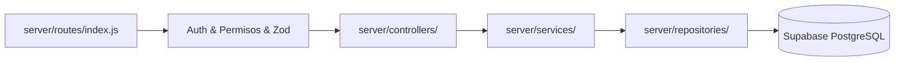
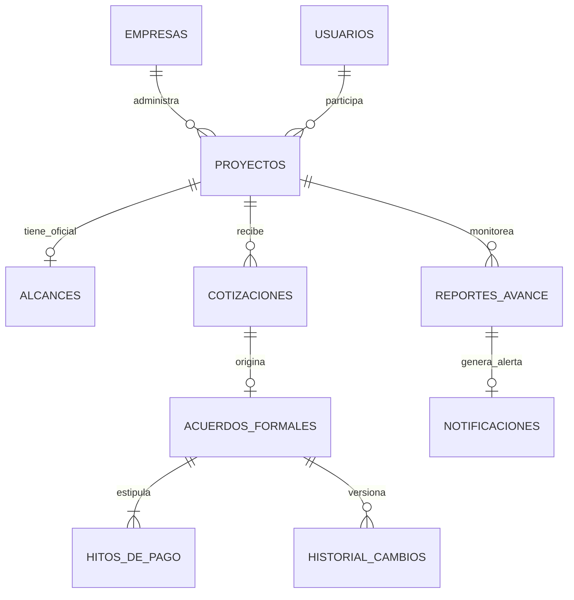

# ⚙️ Módulo Backend & Base de Datos

## 1. Arquitectura de la API Express
El backend (`server/`) implementa una arquitectura desacoplada en tres capas con inyección de cliente Supabase:

---

## 2. Catálogo de Endpoints REST

| Método | Endpoint | Caso de Uso | Roles Permitidos | Descripción |
| :--- | :--- | :---: | :--- | :--- |
| `GET` | `/health` | RNF-04 | Público | Chequeo de estado de la API y de conexión a la BD. |
| `GET` | `/me` | RNF-03 | Autenticado | Obtiene el perfil y rol del usuario en sesión. |
| `GET` | `/proyectos` | — | Autenticado | Lista los proyectos visibles para el usuario según RLS. |
| `GET` | `/portafolio` | UC6 | `coordinador`, `gerencia` | Consolidado global de costos, avances y desviaciones. |
| `GET` | `/proyectos/:id/alcance` | UC1 | Autenticado | Consulta el alcance oficial o borrador del proyecto. |
| `PUT` | `/proyectos/:id/alcance` | UC1 | `coordinador`, `auxiliar` | Guarda borrador del alcance validado con Zod. |
| `POST` | `/proyectos/:id/alcance/oficializar` | UC1 | `coordinador` | Sella el alcance como oficial único. |
| `GET` | `/proyectos/:id/cotizaciones` | UC2 | `contratista`, `coordinador` | Lista cotizaciones emitidas para el proyecto. |
| `POST` | `/proyectos/:id/cotizaciones` | UC2 | `contratista` | Registra cotización estructurada en 5 rubros. |
| `GET` | `/proyectos/:id/comparacion` | UC3 | `coordinador`, `gerencia` | Obtiene comparativa estructurada lado a lado. |
| `POST` | `/cotizaciones/:id/aceptar` | UC4 | `coordinador` | Acepta la cotización y genera el Acuerdo Formal. |
| `GET` | `/proyectos/:id/acuerdo` | UC4 | Autenticado | Consulta el acuerdo vigente y sus hitos de pago. |
| `POST` | `/proyectos/:id/avances` | UC5 | `contratista` | Registra porcentaje y costo real de materiales. |
| `POST` | `/hitos/:id/pagar` | UC8 | `coordinador` | Registra desembolso formal con comprobante. |
| `POST` | `/acuerdos/:id/cambios-alcance` | UC9 | `coordinador` | Registra cambio justificado e inmutable (US-10). |

---

## 3. Esquema de Base de Datos (PostgreSQL)

El esquema se despliega mediante migraciones SQL versionadas en `supabase/migrations/`:

### 3.1 Tablas Principales:
1. `usuarios`: Identidad, email y rol (`coordinador`, `auxiliar`, `contratista`, `cliente`, `gerencia`).
2. `proyectos`: Estado de obra (`PLANIFICACION`, `COTIZACION`, `EN_EJECUCION`, `FINALIZADO`), cliente y presupuesto.
3. `alcances`: Ambientes, partidas y materiales en formato estructurado JSONB.
4. `cotizaciones`: Materiales, mano de obra, imprevistos, tiempo, forma de pago y exclusiones.
5. `acuerdos_formales`: Precio total, fecha de firma y responsabilidades.
6. `hitos_de_pago`: Monto, porcentaje de obra, condición de avance y estado (`PENDIENTE`, `APROBADO`, `PAGADO`).
7. `reportes_avance`: Porcentaje completado, costo incurrido y cálculo de desviación.
8. `historial_cambios`: Auditoría inmutable con fecha, autor y justificación obligatoria.
9. `notificaciones`: Cola transaccional para el servicio de correo asíncrono.

---

## 4. Reglas de Negocio en Postgres (Triggers & Constraints)
* **Un solo alcance oficial (US-01):** Índice único parcial `CREATE UNIQUE INDEX idx_alcance_oficial ON alcances(proyecto_id) WHERE es_oficial = true;`
* **Un solo acuerdo vigente (US-04):** Índice único parcial `CREATE UNIQUE INDEX idx_acuerdo_vigente ON acuerdos_formales(proyecto_id) WHERE estado = 'VIGENTE';`
* **Un hito no se paga dos veces (US-07):** Trigger `BEFORE UPDATE` que rechaza transiciones desde `PAGADO` a cualquier otro estado.
* **Historial inmutable (US-10 / RNF-02):** Trigger `BEFORE UPDATE OR DELETE` sobre `historial_cambios` que lanza excepción `RAISE EXCEPTION 'El historial de cambios es inmutable'`.
* **Alerta inmediata de desviación (US-06):** Trigger `AFTER INSERT` sobre `reportes_avance` que evalúa si el costo real excede el umbral configurado de la empresa e inserta una fila en `notificaciones`.
